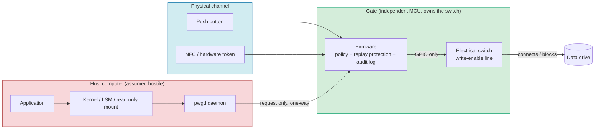

# Physical Isolation Wall · 物理隔离墙

**A hardware write gate between your computer and the data you cannot afford to lose.**

[中文版](README.zh-CN.md) · [Design docs](docs/) · [Roadmap](docs/05-roadmap.md) · [Contributing](CONTRIBUTING.md) · [Security policy](SECURITY.md)

> Status: **concept stage — RFC-0001 open for adoption.** No reference hardware exists yet. This repository exists to be argued with, forked, and improved.

---

## 1. The problem

A modern computer has exactly one notion of authority: a bit in memory. If a process holds the right bit — `uid 0`, a capability, a signed driver, a valid token in the TPM — it can do anything to any disk. There is no remaining physical step between "software thinks you are allowed" and "the platter/NAND is being written".

This was tolerable while attacks were written by humans, at human speed, against known bug classes. It is no longer. Automated vulnerability discovery, prompt-injected agents, and self-directed tooling change the economics: the attacker's search space is now unbounded and cheap, while every defense you build is still a finite list of checks that someone can enumerate and route around.

**Software mitigations raise the cost of an attack. They cannot change what is possible.** As long as a data path exists at the electrical level, that path is reachable by anything that owns the CPU.

There is exactly one class of control that changes possibility rather than cost: **removing the path**, or making the path's existence depend on a physical event that no software can synthesize.

That is what this project is about — not encryption, not permissions, not "zero trust", but a **gate**.

---

## 2. The idea in one sentence

> Your important data drive stops being a path in the operating system and becomes a **room with a door**, and that door is opened by a human hand standing in front of the machine — never by a message on a bus.

Three design commitments follow from that sentence:

| Commitment | Meaning |
|---|---|
| **Default closed** | With no power, no firmware, a crashed gate, or a fully compromised host, the drive is disconnected or read-only. Safety lives in the resting state. |
| **Two independent channels** | The host may *request*. Only the physical channel may *grant*. Nothing the host can send, flash, or write can produce a grant. |
| **Minimum window** | Every grant is a single-use, time-bounded, scope-bounded **write session** — not a mode you switch on. |

---

## 3. How it works



The host's request line is **data-only and inbound to the gate**. There is no return path that can carry an authorisation, and no register the host can write to close the switch. The only thing that moves the switch is a GPIO pin owned by a microcontroller whose firmware the host cannot reflash while the gate is armed.

### 3.1 A write session, step by step

1. **Intent.** An application asks `pwgd` to write. The request is normalised into a *scope*: target volume, block range or file set, maximum bytes, and a purpose string. Requests without a purpose are rejected at the daemon.
2. **Proposal.** `pwgd` packages the request into a fixed-format frame: `{session_id, nonce, scope, byte_budget, ttl, hash}` and sends it over a one-way link (UART / USB CDC / SPI) to the gate.
3. **Display & presence.** The gate shows the proposal on its own tiny display (or a fixed LED pattern plus an audio read-back). It does **not** trust the host's rendering.
4. **Physical confirmation.** The operator presses a hardware button *and* presents an NFC card (or inserts a hardware token). Either alone is insufficient. This ordering — see first, then confirm — is what makes the gate resistant to remote approval.
5. **Grant.** The gate checks its own counters: is this nonce unused, is the daily byte budget intact, is this scope inside the policy burned into the gate at provisioning time? If yes, it closes the switch and starts a **hardware watchdog** — a timer inside the MCU, which the host cannot extend, pause, or read.
6. **Execution.** The host writes. It may write only inside the declared scope; the gate's bridge layer drops out-of-scope block commands rather than trusting the host to behave.
7. **Settlement.** On expiry, on switch-close, or on any anomaly (unexpected reset, out-of-scope access, watchdog pre-warning), the gate opens the circuit, returns to read-only, appends the session to its hash-chained log, and requires a fresh physical confirmation for anything further.
8. **Verification (optional but recommended).** The host re-reads the written range and compares hashes; the result is logged as part of the session record, so a silent corruption or a partial write is visible afterwards, not discovered years later.

### 3.2 What "physical" is doing in that word

Not everything in the chain above is equally strong. We are explicit about this, because a project that calls a udev rule "physical isolation" is lying to its users.

| Tier | Mechanism | Defeated by a fully compromised host? |
|---|---|---|
| **A — Electrical** | The write-enable line is a wire driven by an MCU GPIO. No bus transaction exists that can assert it. Circuit open = no writes, physically. | **No.** |
| **A — Electrical** | Hard power cut to the drive (or to its PHY) when not in a session. | **No.** |
| **B — Hardware logic** | The bridge firmware inspects and filters block commands on an independent SoC. Host has no write access to that firmware. | No, *provided* the gate's own firmware and silicon are honest — this is the assumption the project must earn through reproducible builds, open design, and independent review. |
| **C — Operating system** | Read-only mounts, `blockdev --setro`, LSM/eBPF rules, USB authorisation (USBGuard), immutable boot. | **Yes.** These reduce accidents and shrink blast radius. They are **not** the security boundary, and the docs never present them as one. |

**Project rule:** any claim of protection must land in tier A or B, or be labelled explicitly as tier C convenience.

---

## 4. What this protects against — and what it does not

### It is designed against

- A host fully owned by an attacker: rootkit, malicious driver, supply-chain compromise in an application, a prompt-injected agent with a shell.
- Ransomware and mass-exfiltration payloads that arrive by any route and then try to touch the archive drive.
- An AI agent that is technically capable of deleting or encrypting everything it can see, and is not deterred by warnings.
- Accidental destructive writes by a human or a script at 3 a.m.
- Theft of the machine while it is switched off: the archive drive is not readable without also taking the gate, and the gate can be provisioned to wipe its keys on tamper.

### It is not designed against

- **Abuse inside an approved window.** If an operator approves 200 MB, a compromised host can write 200 MB of garbage. The defence is window minimisation (default TTL 60 s, default budget in the low hundreds of MB), hysteresis, and post-hoc verification — not the fantasy of a safe write.
- **Coercion.** Someone who can make the operator press the button has the authority the button carries. Duress codes (see [docs/02 §6](docs/02-architecture.md#6-duress-and-plausible-deniability)) mitigate this partially; nothing eliminates it.
- **Physical teardown of the gate.** Optional tamper mesh, potting, and key-erase-on-open raise the bar; they do not close the class.
- **Side channels.** Power, EM, and timing leakage from the bridge are out of scope for v0.1 and explicitly listed as open research.
- **A malicious gate.** An attacker who can reflash the gate's own firmware has replaced the root of trust. Mitigations: signed firmware, write-protected boot, reproducible builds, and published hardware anyone can inspect.
- **Reading.** This project gates *writes*. Read-only access to the archive remains available, because gating reads destroys usability. A "read-gated" profile exists in the design notes for the paranoid case.

Every one of these limitations is stated in the README on purpose. A security project whose front page only lists wins is a marketing page.

---

## 5. Hardware forms

The gate can be built at three levels of ambition. Start at M0; the protocol is identical at every level, which is why the effort is not wasted.

| Level | Form | Approx cost | Difficulty | Notes |
|---|---|---|---|---|
| **M0** | **Air-gap timer**: RP2040 + USB 2.0 mux + VBUS load switch. The archive drive is fully offline by default and comes online for *N* minutes (default 10) on physical approval | $15–40 | One evening | The strongest electrical tier available at hobby cost — a real A-rated cut. All-or-nothing: the drive is not readable while offline, because USB 2.0 has no separable write direction. |
| **M1** | SBC bridge (CM4 / RK3566): USB gadget toward the host, SATA or NVMe toward the drive, GPIO from an independent MCU owns the enable line | $80–150 | A few weekends | The recommended reference design. The bridge can filter block commands; the MCU owns the switch, so host compromise cannot reach it. |
| **M2** | Custom PCB with a SATA/NVMe pass-through path | $300+ per prototype | Months, needs a signal-integrity engineer | 6 Gb/s differential pairs through a mux need redrivers; this is the part that genuinely needs expert help. |
| **M3** | Productised, certified, tamper-resistant | — | — | EMC, ESD, radio certification, side-channel review. |

Details, BOMs, and pin-level notes: [docs/03-hardware.md](docs/03-hardware.md).

---

## 6. The five-level check chain

"Multi-level inspection" sounds like defence in depth. In practice, only the last two levels below carry weight — everything above them is a courtesy.

| Level | Where | Job | Security weight |
|---|---|---|---|
| L0 | Application | Declare intent: what, why, how much | None (convenience) |
| L1 | Kernel | Refuse obviously wrong writes early; keep the drive read-only when idle | Low — shrinks blast radius |
| L2 | `pwgd` daemon | Normalise intent into a signed, replay-proof request frame | Low — but it is where abuse becomes visible |
| L3 | Gate firmware | Verify nonce, budget, scope, rate limits; own the counters | **High** |
| L4 | Physical channel | Button + NFC/token; human sees the proposal first | **High** |
| L5 | Circuit | Switch closes only while the session is live; opens on any anomaly | **Highest** |

Any design that collapses L3–L5 into "the daemon decides" has failed this project's only premise.

---

## 7. Repository layout

```
.
├── README.md              ← you are here (English)
├── README.zh-CN.md        ← 中文版
├── docs/
│   ├── 01-threat-model.md     Assets, adversaries, trust boundaries, residual risk
│   ├── 02-architecture.md     Protocol, session state machine, log format, duress mode
│   ├── 03-hardware.md         M0–M2 reference designs, BOM, pinout, open questions
│   ├── 04-software.md         pwgd, CLI, kernel-side hardening, packaging
│   └── 05-roadmap.md          Milestones, RFC index, what help is needed where
├── CONTRIBUTING.md        Contribution rules and review standards
├── SECURITY.md            How to report a vulnerability; what we promise
├── PUBLISHING.md          How to push this to GitHub (step by step, Windows-friendly)
├── LICENSE                Licensing summary for code / hardware / docs
└── .gitignore
```

---

## 8. What this project needs from you

The author is a single practitioner, not a hardware lab. This is deliberately published as a *seed*, not a product. The pieces that need other people:

| Area | What is needed | Who |
|---|---|---|
| Signal integrity / PCB | SATA/NVMe pass-through with redrivers; a 4-layer reference board for M0/M1 | Hardware engineer |
| Firmware | Rust or C on RP2040/STM32: switch control, watchdog, hash-chained log, NFC stack | Embedded developer |
| Host software | `pwgd` in Rust, one-way protocol on Linux and Windows, packaging for Debian/Arch/Windows | Systems developer |
| Kernel / storage | Read-only enforcement that fails closed, device-mapper snapshot-on-write hook | Linux storage developer |
| Security review | Threat model attack, protocol cryptanalysis, fuzzing the request frame | Anyone who breaks things for a living |
| Law / compliance | Radio (13.56 MHz NFC), cryptography export rules, open-hardware licensing | Counsel |
| Documentation | Translation, diagrams, a "why this matters" essay aimed at non-engineers | Writer |

If you only have an opinion, that is still useful — open an issue titled `RFC:` with your objection. **The most valuable contribution to a project like this is a well-argued reason it cannot work.**

---

## 9. Related work (read these before forking)

This is not a green field. Be honest about what already exists:

- **Forensic write blockers** — Tableau, CRU WiebeTech, Guardonix, and similar commercial bridges intercept mass-storage commands and strip writes. They prove the mechanism works, but they are *unconditionally* read-only: there is no approved write window, and switching modes usually requires a power cycle. ([example test report](https://www.dhs.gov/sites/default/files/publications/testresults_for_cool_gear_sata-ide_adapter_linux.pdf))
- **BusKill** — an open-source USB kill cord: a magnetic breakaway that locks, shuts down, or shreds keys when the machine is separated from its operator. Same philosophy (physical presence as a security primitive), different threat: theft, not malware. ([buskill.in](https://www.buskill.in/))
- **USBGuard** — Linux device authorisation framework; the canonical tier-C layer. ([usbguard.github.io](https://usbguard.github.io/))
- **NVMe write protection** — the base spec defines a namespace write-protect feature and a `WRITE_PROTECTED` namespace attribute; it is a *command-level* lock, useful as an extra tier-B guard, not a physical one. ([libnvme manual](https://manpages.ubuntu.com/manpages/noble/man2/nvme_set_features_write_protect.2.html))
- **Linux USB mass-storage gadget** — `configfs` LUNs expose a `ro` attribute and fall back to read-only when a backing file cannot be opened for writing; this is the cheapest tier-B bridge. ([kernel docs](https://www.kernel.org/doc/html/latest/usb/mass-storage.html))
- **Distance bounding** — UWB time-of-flight ranging is the standard defence against relay attacks on proximity credentials; relevant if the NFC token is ever replaced by a wireless one. ([USENIX Security '24, PURE](https://www.usenix.org/system/files/usenixsecurity24-coppola.pdf))

The gap this project aims at: **a write blocker that can be opened, once, by a human, for a bounded amount of data, and that records what happened.**

---

## 10. Licensing

Three licences, because three kinds of work:

| Part | Licence |
|---|---|---|
| Software (host, firmware) | Apache-2.0 |
| Hardware design files | CERN-OHL-S-2.0 |
| Documentation | CC BY 4.0 |

See [LICENSE](LICENSE) for the summary and the notice text to copy into design files.

---

## 11. Safety and legal notice

- This design deliberately makes writing *inconvenient*. Do not deploy it on a machine that must remain unattended and writable; a gated drive that nobody can approve is a drive that is effectively offline.
- NFC and other radio parts are subject to regional spectrum rules; the M0 reference design uses only passive 13.56 MHz reader hardware and must be certified before sale in any jurisdiction.
- Cryptographic components may be subject to export-control and, in some jurisdictions, registration requirements. Contributors are responsible for their own compliance.
- A gate is not a backup. Keep backups. A project that convinces you to skip backups has harmed you.

---

*Started as a single person's answer to a question that will not go away: if the software can no longer be trusted, what is left that a person can actually hold?*
