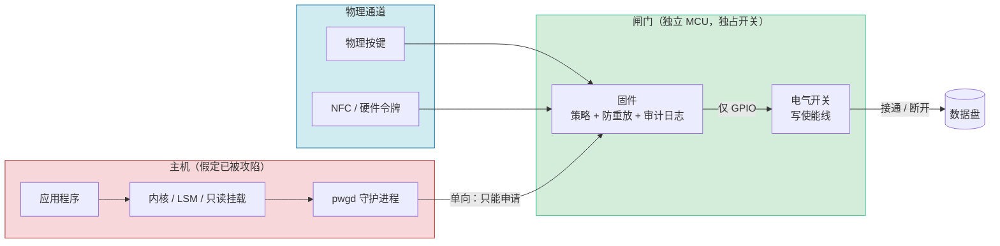

# 物理隔离墙 · Physical Isolation Wall

**在电脑与你输不起的数据之间，装一道硬件闸门。**

[English](README.md) · [设计文档](docs/) · [路线图](docs/05-roadmap.md) · [参与贡献](CONTRIBUTING.md) · [安全政策](SECURITY.md)

> 状态：**概念阶段 —— RFC-0001 公开征集认领。** 目前没有任何参考硬件。这个仓库存在的意义，是被质疑、被分叉、被改得更好。

---

## 一、问题出在哪

现代电脑只有一种"权限"概念：内存里的一个位。

只要一个进程拿到那个位——`uid 0`、一个 capability、一个签名过的驱动、TPM 里一张有效的令牌——它就能对任何磁盘做任何事。从"软件认为你被允许"到"磁盘的磁道或闪存真的被改写"，中间**没有剩下任何一步物理动作**。

攻击还由人类按人类速度编写、只针对已知的漏洞类别时，这种设计勉强说得过去。现在不行了。自动化的漏洞挖掘、被提示注入驱动的智能体、会自己调工具的进程，把经济学彻底改了：攻击者的搜索空间变成无界且廉价，而你的每一层防御仍然是一份有限的检查清单，可以被逐条枚举、逐条绕过。

**软件层面的缓解只能提高攻击成本，改变不了"能不能"。** 只要数据通路在电气层面还存在，它就能被任何占住了 CPU 的东西走到。

只有一类控制改变的是"能不能"而不是"成本"：**把路拆掉**，或者让路的存在取决于一个软件无法伪造的物理事件。

这个项目做的不是加密，不是权限，也不是"零信任"，而是一道**闸门**。

---

## 二、一句话说清楚

> 你那块重要的数据盘，不再只是操作系统里的一条路径，而变成一个**有门的房间**；门由站在机器前的人亲手打开，永远不由总线上的一条消息打开。

由此产生三条设计承诺：

| 承诺 | 含义 |
|---|---|
| **默认关闭** | 断电、固件崩溃、闸门死机、主机被完全攻陷——数据盘都处于断开或只读状态。安全性存在于静止态。 |
| **双通道分离** | 主机只能"申请"，只有物理通道能"批准"。主机无论发什么、刷什么、写什么寄存器，都变不出一次批准。 |
| **窗口最小** | 每次批准都是一个一次性、限时、限范围的**写会话**，而不是打开一个长期开关。 |

---

## 三、它怎么工作



主机那根"申请线"是**单向的、只进不出**：它送不进任何授权，也没有任何可写寄存器能合上开关。真正拨动开关的，是一个只有在闸门被解除武装时才能刷写的 MCU 所拥有的一根 GPIO。

### 3.1 一次写会话的完整过程

1. **意图。** 应用向 `pwgd` 提出写入。请求被归一化成"范围"：目标卷、块区间或文件集、字节上限、用途说明。**没有用途说明的请求在守护进程就被拒掉。**
2. **提案。** `pwgd` 把请求打包成固定格式的帧 `{session_id, nonce, scope, byte_budget, ttl, hash}`，通过单向链路（UART / USB CDC / SPI）送到闸门。
3. **显示与在场。** 闸门在**自己的**小屏（或固定的 LED 组合加语音回读）上显示这次提案。它不信任主机渲染的任何界面——主机上的"确认对话框"在这个设计里没有任何位置。
4. **物理确认。** 操作者按下硬件按键，**并且**刷一张 NFC 卡（或插入硬件令牌）。两者缺一不可。这个顺序——先看见，再确认——是它抗远程批准的根本。
5. **批准。** 闸门查自己的计数器：这个 nonce 用过没有？当日字节额度还剩多少？这个范围在烧录进闸门的策略之内吗？三项都过，才合上开关，同时启动**硬件看门狗**——那是 MCU 内部的定时器，主机既不能延长，也不能暂停，也读不到。
6. **执行。** 主机开始写，且只能写在申报范围内。越界的块命令由闸门的桥接层直接丢弃，而不是指望主机自觉。
7. **结算。** 到期、主动关闭、或出现任何异常（意外复位、越界访问、看门狗预警），闸门断开电路，回到只读，把本次会话追加进哈希链日志，并要求下一次操作重新做物理确认。
8. **校验（建议保留）。** 主机回读刚写入的区间并比对哈希，结果作为会话记录的一部分入库。这样一次静默损坏或半截写入当场可见，而不是几年后才发现。

### 3.2 "物理"这两个字到底指什么

上表里的每个环节强度并不相同。必须说清楚——把一个 udev 规则叫成"物理隔离"的项目，是在骗用户。

| 层级 | 机制 | 主机被完全攻陷后还能绕过吗 |
|---|---|---|
| **A 电气层** | 写使能是一根由 MCU GPIO 驱动的线，总线上不存在能拉高它的任何事务。电路断开 = 物理上写不进去。 | **不能。** |
| **A 电气层** | 非会话期间对磁盘（或其 PHY）硬断电。 | **不能。** |
| **B 硬件逻辑层** | 桥接固件在独立 SoC 上检查并过滤块命令，主机对该固件没有写权限。 | 不能——**前提**是闸门自身的固件与芯片是可信的。这个前提得靠可复现构建、开源设计、同行评审去挣，不是靠声明。 |
| **C 操作系统层** | 只读挂载、`blockdev --setro`、LSM/eBPF 规则、USB 授权（USBGuard）、不可变启动。 | **能。** 这些能减少误操作、缩小爆炸半径，但**不是**安全边界，文档里也从不把它写成安全边界。 |

**项目铁律：任何防护声明必须落在 A 级或 B 级；落在 C 级的，必须明确标注为便利性措施。**

---

## 四、它防什么、不防什么

### 设计针对的

- 一台被攻击者完全拥有的主机：rootkit、恶意驱动、某个应用的供应链投毒、一个被提示注入后拿到 shell 的智能体。
- 勒索软件、批量外传的载荷——不管从哪条路进来，最后都要碰归档盘。
- 一个技术上足以删除或加密它看得见的一切、且不会被警告吓住的 AI 智能体。
- 人在凌晨三点的误操作，或脚本的一次手滑。
- 机器关机状态下的整机失窃：没有闸门，归档盘读不出来；闸门可以配置成拆机即擦除密钥。

### 明确不防的

- **批准窗口内的滥用。** 操作者批准了 200 MB，被攻陷的主机就能写 200 MB 垃圾。对策是压缩窗口（默认 TTL 60 秒、默认额度在数百 MB 量级）、迟滞、事后校验——**不是**幻想一次安全的写入。
- **胁迫。** 能逼操作者按键的人，就拥有那个按键所代表的授权。胁迫码（见 [docs/02 §6](docs/02-architecture.md#6-duress-and-plausible-deniability)）只能部分缓解，没有任何东西能消除它。
- **对闸门的物理拆解。** 防拆网、灌封、开盖擦除密钥能提高门槛，但关不上这一类。
- **侧信道。** 桥接器的功耗、电磁、时序泄漏，v0.1 明确不在范围内，列入公开研究课题。
- **恶意的闸门。** 能重刷闸门固件的人，已经把信任根换掉了。缓解手段：签名固件、写保护启动、可复现构建、公开可审查的硬件。
- **读。** 本项目管的是**写**。归档盘的只读访问保持可用，因为把读也管起来会毁掉可用性。设计笔记里留了一个"读也要授权"的偏执档。

这些局限写在 README 里是有意为之：一个首页只列战绩的安全项目，是营销页。

---

## 五、硬件形态

按野心分三档。从 M0 起步，协议在每一档都一致——这也是为什么先做小的不吃亏。

| 档位 | 形态 | 大致成本 | 难度 | 说明 |
|---|---|---|---|---|
| **M0** | **气隙定时器**：RP2040 + USB 2.0 多路开关 + VBUS 负载开关。归档盘默认完全离线，物理确认后上线 *N* 分钟（默认 10） | 100–300 元 | 一个晚上 | 业余成本下能拿到的最高电气等级——一次真正的 A 级切断。全有或全无：离线期间盘是读不到的，因为 USB 2.0 没有可分离的写方向。 |
| **M1** | SBC 桥接（CM4 / RK3566）：面向主机走 USB gadget，面向磁盘走 SATA 或 NVMe，使能线由一个独立 MCU 的 GPIO 掌管 | 600–1100 元 | 几个周末 | 推荐的参考设计。桥接层能过滤块命令；开关归 MCU 所有，主机攻陷也够不着。 |
| **M2** | 自制 PCB，SATA/NVMe 直通路径 | 单板 2000 元以上 | 数月，需要信号完整性工程师 | 6 Gb/s 差分对穿过多路开关必须加 redriver。这一档才是真正需要专家帮手的部分。 |
| **M3** | 产品化：认证、防拆 | — | — | EMC、ESD、无线电认证、侧信道评审。 |

细节、BOM、引脚级说明见 [docs/03-hardware.md](docs/03-hardware.md)。

---

## 六、五级检查链

所谓"多级检查"，本设计给出的是一条**只有最后两级承重**的链条：

| 级别 | 位置 | 职责 | 安全权重 |
|---|---|---|---|
| L0 | 应用层 | 声明意图：写什么、为什么、写多少 | 无（纯便利） |
| L1 | 内核层 | 尽早拒掉明显错误的写入；空闲时保持盘只读 | 低 —— 缩小爆炸半径 |
| L2 | `pwgd` 守护进程 | 把意图归一化成签名、防重放的请求帧 | 低 —— 但滥用在这里变得可见 |
| L3 | 闸门固件 | 校验 nonce、额度、范围、速率；计数器归它自己 | **高** |
| L4 | 物理通道 | 按键 + NFC/令牌；人先看见提案 | **高** |
| L5 | 电路层 | 仅会话存活期间闭合；任何异常立即断开 | **最高** |

任何把 L3–L5 简化成"由守护进程决定"的设计，都已经丢掉了本项目唯一的前提。

---

## 七、仓库结构

```
.
├── README.md              ← 英文版
├── README.zh-CN.md        ← 你正在看的中文版
├── docs/
│   ├── 01-threat-model.md     资产、对手、信任边界、残余风险
│   ├── 02-architecture.md     协议、会话状态机、日志格式、胁迫模式
│   ├── 03-hardware.md         M0–M2 参考设计、BOM、引脚、待解问题
│   ├── 04-software.md         pwgd、命令行、内核侧加固、打包
│   └── 05-roadmap.md          里程碑、RFC 索引、哪里最需要人
├── CONTRIBUTING.md        贡献规则与评审标准
├── SECURITY.md            漏洞报告渠道与承诺
├── PUBLISHING.md          如何推上 GitHub（分步，适配 Windows）
├── LICENSE                代码 / 硬件 / 文档的许可摘要
└── .gitignore
```

---

## 八、这个项目需要你做什么

作者是一个人在做这件事，不是一个硬件实验室。所以它是**一颗种子**，不是一款产品。需要别人的地方很具体：

| 方向 | 需要什么 | 适合谁 |
|---|---|---|
| 信号完整性 / PCB | SATA/NVMe 直通加 redriver；M0/M1 的四层参考板 | 硬件工程师 |
| 固件 | RP2040/STM32 上用 Rust 或 C：开关控制、看门狗、哈希链日志、NFC 协议栈 | 嵌入式开发者 |
| 主机软件 | Rust 版 `pwgd`，Linux 与 Windows 的单向协议实现，Debian/Arch/Windows 打包 | 系统开发者 |
| 内核 / 存储 | 失败即关闭的只读强制、device-mapper 写前快照钩子 | Linux 存储开发者 |
| 安全评审 | 攻击威胁模型、协议分析、请求帧模糊测试 | 以破坏为业的人 |
| 法律 / 合规 | 13.56 MHz NFC 的无线电法规、密码出口管制、开源硬件许可 | 法务 |
| 文档 | 翻译、配图、写给非工程师看的"为什么这事重要" | 写作者 |

哪怕你只有一个观点，也有用——开一个标题以 `RFC:` 开头的 issue 说出你的反对意见。**对这类项目最有价值的贡献，是一个论证充分的"它做不成"的理由。**

---

## 九、已有的相关工作（分叉之前先读）

这不是一片空地。诚实地列出已经存在的东西：

- **取证级写阻断器** —— Tableau、CRU WiebeTech、Guardonix 之类的商用桥接器会拦截大容量存储命令并剥掉写操作。它们证明这条机制可行，但它们是**无条件只读**：没有"经批准的写窗口"，且切换模式通常要断电重启。（[一份公开测试报告](https://www.dhs.gov/sites/default/files/publications/testresults_for_cool_gear_sata-ide_adapter_linux.pdf)）
- **BusKill** —— 开源的 USB 断线绳：磁吸断开触发锁屏、关机或销毁密钥。哲学相同（把物理在场当作安全原语），威胁模型不同：它防的是失窃，不是恶意软件。（[buskill.in](https://www.buskill.in/)）
- **USBGuard** —— Linux 设备授权框架，典型的 C 级层。（[usbguard.github.io](https://usbguard.github.io/)）
- **NVMe 写保护** —— 基础规范定义了命名空间写保护特性与 `WRITE_PROTECTED` 属性；它是**命令级**的锁，可作为额外的 B 级保护，但不是物理手段。（[libnvme 手册](https://manpages.ubuntu.com/manpages/noble/man2/nvme_set_features_write_protect.2.html)）
- **Linux USB 大容量存储 gadget** —— `configfs` 的 LUN 有 `ro` 属性，且在后备文件无法以读写方式打开时会自动回落为只读；这是最便宜的 B 级桥接实现。（[内核文档](https://www.kernel.org/doc/html/latest/usb/mass-storage.html)）
- **距离绑定（distance bounding）** —— UWB 飞行时间测距是防中继攻击的标准手段；如果将来把 NFC 令牌换成无线令牌，这一块必须补上。（[USENIX Security '24, PURE](https://www.usenix.org/system/files/usenixsecurity24-coppola.pdf)）

本项目瞄准的空档是：**一台能被人打开一次、只为有限数据量放开、并且把发生过什么记下来的写阻断器。**

---

## 十、许可

三类工作，三份许可：

| 部分 | 许可 |
|---|---|
| 软件（主机侧、固件） | Apache-2.0 |
| 硬件设计文件 | CERN-OHL-S-2.0 |
| 文档 | CC BY 4.0 |

摘要与要抄进设计文件的声明文本见 [LICENSE](LICENSE)。

---

## 十一、安全与法律提示

- 这个设计是**故意让写入变麻烦**的。不要把它部署在一台必须无人值守持续可写的机器上——一块没人能批准的盘，等于离线。
- NFC 等无线电部件受各地频谱法规约束；M0 参考设计只用无源 13.56 MHz 读卡硬件，任何地区销售前都必须做认证。
- 密码学组件可能受出口管制及部分地区登记要求约束，贡献者自行负责合规。
- **闸门不是备份。** 请继续做备份。一个让你放弃备份的项目，是在害你。

---

*它起始于一个人对一个赶不走的问题的回答：当软件不再可信，还剩什么是一个人真正能握在手里的？*
