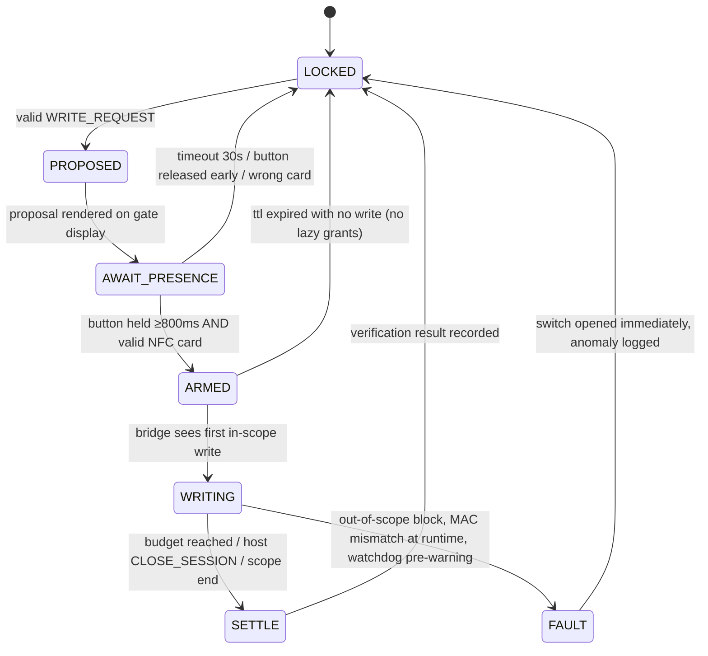

# 02 · Architecture and Protocol

[English](#1-roles) · [中文摘要](#中文摘要)

---

## 1. Roles

| Component | Runs on | Trust | Responsibility |
|---|---|---|---|
| `pwguard` / application | host | none | Declares intent |
| `pwgd` | host | low | Normalises intent, builds request frames, surfaces status |
| **Gate firmware** | MCU (independent) | **high** | Policy, counters, switch, watchdog, log |
| **Bridge layer** | SBC / ASIC | **medium** | Block-level filtering, read-only by default |
| **Presence channel** | button + NFC reader | **high** | The only source of authorisation |

The gate is the root of trust. Everything else is a convenience layer that may be replaced by an attacker at any time.

---

## 2. Protocol

### 2.1 Transport

A single simplex link, chosen for the level:

| Level | Link | Direction enforcement |
|---|---|---|
| M0 | USB CDC-ACM | Soft: firmware never accepts commands on the same endpoint; hard: use a UART with the TX line of the host physically cut, gate's RX only |
| M1 | UART 115200 8N1 | **Hard**: only the host's TX is wired to the gate's RX. The return path is a separate opto-isolated LED line, write-only from gate to a status LED, carrying no authorisation |
| M2 | SPI slave, gate as slave with a one-way data path | Hard, by PCB routing |

The recommended enforcement is the M1 arrangement precisely because it is *physically* one-way: there is a wire from the host and no wire back that can carry meaning. A compromise of the host cannot talk the gate into anything; it can only shout requests into a microphone.

### 2.2 Request frame (host → gate), 64 bytes fixed

```
off  size  field
 0    2    magic           0x50 0x57 ("PW")
 2    1    version         0x01
 3    1    msg_type        0x01 WRITE_REQUEST
                           0x02 UNLOCK_REQUEST   (open encrypted volume for reading)
                           0x03 STATUS_REQUEST
                           0x04 CLOSE_SESSION
 4    4    session_id      random, host-chosen; echo only
 8    8    nonce           monotonic, strict increase per (device, boot epoch)
16    8    byte_budget     bytes this session may write
24    4    ttl_ms          requested lifetime, capped by gate policy
28    8    lba_start       first logical block
36    8    lba_len         block count
44    2    purpose_code    enum: BACKUP=1, EDIT=2, RESTORE=3, MIGRATE=4, OTHER=255
46    2    flags           bit0 dry-run, bit1 verify-after-write, others reserved
48   16    mac             HMAC-SHA256(key_k_req, bytes[0..47]) truncated to 128 bits
```

Design notes:

- **Fixed size, no variable-length fields.** Variable-length parsing is where firmware memory bugs live. If the payload a user wants to describe cannot fit in the scope fields, the answer is a new `msg_type`, not a longer frame.
- **The MAC key is per-device, burned at provisioning, never leaves the MCU.** A host that learns it gains the ability to *propose*, not to *approve*. Compromise of the host therefore degrades to "the attacker can ask loudly", which is the intended ceiling.
- **`byte_budget` and `lba_len` are checked twice:** once at grant, again at settlement against a hardware counter that increments per block actually passed through the bridge.
- **`ttl_ms` is a request, never a right.** The gate clamps it to its own maximum (default 60 000 ms, floor 5 000 ms).

### 2.3 Response frame (gate → host, where a return path exists), 32 bytes

```
off  size  field
 0    2    magic 0x50 0x57
 2    1    version
 3    1    msg_type    0x81 STATE, 0x82 ERROR, 0x83 LOG_RECORD
 4    4    session_id
 8    1    state       see §3
 9    1    error_code  0x01 BAD_MAC, 0x02 REPLAY, 0x03 OUT_OF_SCOPE,
                       0x04 BUDGET_EXHAUSTED, 0x05 NO_PRESENCE, 0x06 WATCHDOG
10    6    reserved
16   16    mac
```

A response **never carries authority**. The switch is closed by the MCU, and the host observes that closure only indirectly — as write commands beginning to succeed. A forged `STATE=ARMED` buys an attacker nothing.

This asymmetry is the point. Most competing designs put "grant" in the response, which means the grant is a message, which means it can be forged or relayed.

---

## 3. Session state machine



Hard rules enforced in firmware:

1. `LOCKED` is the only state after power-on, brown-out, or watchdog reset.
2. At most one session may exist. There is no queue, no "approve for the next hour".
3. A session expires with `ttl_ms` even if the host never writes. **Grants do not survive idleness.**
4. Any state transition into `FAULT` must physically open the switch before writing the log entry — the log must not delay safety.
5. `ARMED` requires the button **and** the card. Firmware treats a valid card alone as `NO_PRESENCE`, and button alone likewise.

---

## 4. Key custody — the part that makes the rest meaningful

Without this, [threat 5.1](01-threat-model.md#4-attack-tree-against-the-gate) is unanswerable: the attacker removes the drive and reads it.

### 4.1 Mode K1 — Gate as KEK holder (recommended)

- The archive volume is encrypted (LUKS2 / BitLocker / SED with its own key).
- The volume's key-encryption-key (KEK) is stored **inside the gate**, in MCU-protected storage or an external secure element (ATECC608 / SE050 class).
- On boot, the host receives the KEK only after a presence event — this makes **every cold boot a physical act**, which is desirable: it means a stolen, powered-off machine is a brick.
- Once unlocked, the volume stays readable for the session; the write path remains gated independently.
- On tamper detection (case opened, repeated failed presence, anti-rollback violation), the gate zeroises the KEK. The data is then gone — that is the point, and it must be documented loudly.

### 4.2 Mode K0 — Clear-text drive (demo only)

The gate still blocks writes at the electrical level, but a screwdriver defeats it. Acceptable only for development and for the "protect against my own mistake" use case. Marking a K0 configuration as secure is forbidden by [CONTRIBUTING](../CONTRIBUTING.md).

### 4.3 Provisioning

One-time, over a physical service port, with the case open:

1. Generate device identity key; burn into OTP.
2. Generate `key_k_req`; print a paper recovery share (BIP-39 style mnemonic, 24 words) that the operator stores offline.
3. Program scope policy: maximum LBA range, daily byte budget (default 2 GiB), sessions per day (default 20), TTL cap.
4. Enrol NFC cards; each card holds a unique UID plus a challenge-response secret. A card is not a bearer token that can be cloned by reading a UID.
5. Seal the case; record a provisioning receipt signed by the device.

Re-provisioning requires physical disarm and wipes the log — which itself is a logged event, appended as `PROVISION_RESET` with a marker that no audit is available for the gap.

---

## 5. Audit log

Each record is fixed 128 bytes:

```
seq           8   monotonic, never reused
timestamp     8   gate RTC, monotonic-checked at boot
event_type    1   SESSION, FAULT, TAMPER, BOOT, PROVISION_RESET
state_seq     1   number of transitions in this session
scope_start   8
scope_len     8
bytes_actual  8   counted in hardware
result        1   OK / FAIL_VERIFY / ABORT / DROP
prev_hash    16   first 16 bytes of SHA-256(previous record)
reserved      20
signature    40   Ed25519 over the canonical record, optional in v0.1
```

Storage policy:

- Stored on a dedicated small flash region or FRAM, append-only, with a write-pointer that is never rewound by firmware.
- Wrapped at 4096 records; wrapping requires physical presence and produces an `ARCHIVE_ROLL` event.
- **Anchor export:** on demand, the gate emits a signed digest of the last N records to a write-once medium or a QR code printed on paper. This is the only way to prove a log was not reconstructed after the fact. Paper is the one append-only medium that survives a compromised host.

Threat addressed: an attacker who owns the host can suppress *host-side* logs at will. They cannot suppress a record whose only writer is an MCU they cannot reach.

---

## 6. Duress and plausible deniability

Optional, off by default, documented because it is the honest answer to AD6.

- **Duress card:** a second NFC card that produces a structurally valid unlock, but drives the gate into a *shadow* configuration — a decoy volume with plausible-looking older content, write window opened but confined to the decoy.
- The operator sees a small, non-obvious indicator (e.g. the status LED breathes instead of holding steady) that only they know how to read.
- All duress events are logged with a `DURESS` marker and are the first records exported to the anchor medium.
- Limits: a sophisticated coercer who knows this project exists will check. Deniability is a delay, not a shield. Never sell it as protection.

---

## 7. Failure modes and what the gate does

| Failure | Behaviour | Rationale |
|---|---|---|
| Host sends malformed frame | Drop, increment `BAD_FRAME` counter, no state change | Fail closed |
| Request link goes silent mid-session | Session continues until TTL, then closes | Silence is not permission, but it is also not evidence of absence |
| Gate power lost | Switch opens; encrypted volume relocks; on restore, cold-boot presence required | Default state is safe |
| Bridge layer hangs | Watchdog on MCU opens switch regardless of bridge state | The MCU, not the bridge, is the authority |
| Log flash full | Refuse new sessions (`LOG_FULL`) until anchored | Degrade to unusable rather than to unauditable |
| NFC reader dies | Button-only is **not** accepted; gate enters `SERVICE_REQUIRED`, unlock by recovery key | … |
| Clock fails | TTL derived from MCU internal oscillator; RTC loss triggers `BOOT` anomaly record | Time is a policy input, so it must not be host-provided |

---

## 8. Open design questions

These are genuinely unsolved and are the most valuable places to contribute:

1. **How the host asks for a write without a returned channel.** Some workflows (databases, package managers, build systems) expect `EIO` to be resolvable inline. A one-way protocol cannot negotiate. Candidate: pre-authorise a small budget on volume mount, consume it, log it.
2. **Fault injection on a $1 MCU.** Voltage glitching can flip a GPIO. Costs of countermeasures (dual-core lockstep, internal oscillator check, randomised re-assert) versus benefit is unmeasured.
3. **SATA/NVMe pass-through signal integrity.** Whether a mux at 6 Gb/s per lane is achievable at hobby cost, or whether the project must permanently accept the bridge architecture.
4. **Log anchoring without paper.** Write-once media is dying; a signed anchor to a third-party transparency log is a design that has not been tried.
5. **Windows-side implementation.** IoRing / StorPort miniport filtering is far less ergonomic than Linux device-mapper. An honest Windows port may require a signed driver and thus a different trust story.

---

## 中文摘要

**角色**：`pwgd`（主机，低信任）只负责把"想写什么"归一化成请求帧；闸门固件（独立 MCU，高信任）掌握策略、计数器、开关、看门狗与日志；桥接层（SBC/ASIC，中信任）做块级过滤；唯一能产生授权的是按键 + NFC 这条物理通道。

**协议三条硬规则**：
1. 请求帧定长 64 字节，**没有变长字段**——固件的内存漏洞几乎都出在变长解析上；要有新语义就加 `msg_type`，不加长帧。
2. 请求帧带 HMAC，密钥烧在 MCU 里永不外泄。主机就算拿到密钥，也只能"提案"，不能"批准"。
3. 响应帧**永远不携带授权**。开关是 MCU 合的，主机只能间接观察到"写命令开始成功"。伪造一个 `STATE=ARMED` 对攻击者毫无价值。这一点正是与市面方案的分歧：凡是把 grant 放进响应的设计，grant 就变成一条可伪造、可中继的消息。

**链路方向**：M1 推荐 UART 只接主机 TX → 闸门 RX，回程只有一根光耦隔离的状态灯线，**物理单向**。主机被攻陷也只能"对麦克风喊"。

**会话状态机**：LOCKED 为唯一上电态；同时只允许一个会话；空闲到期即失效（授权不因闲置而保留）；进入 FAULT 必须先断开电路再写日志；ARMED 必须"按键按住 ≥800ms 且 有效卡"，缺一即为 NO_PRESENCE。

**密钥托管才是根**：K1 模式把卷的 KEK 放在闸门内（MCU 保护区或 ATECC608/SE050 类安全元件），**每次冷启动都需要一次物理在场**，于是"偷走一台关机的电脑"等于"一块砖"；拆机、多次失败、防回滚违规即零化 KEK。K0（明文盘 + 闸门）只允许作为演示，文档中禁止把它宣称成安全方案。

**审计**：128 字节定长记录 + 哈希链 + Ed25519 签名，只增存储；可选"锚点导出"到一次性写入介质或**打印成纸**——纸是唯一能在主机被攻陷后仍然证明确实发生过的介质。

**胁迫模式**：第二张卡产生结构有效的解锁，但进入影子卷；有只有本人看得懂的隐蔽指示；不宣称这是防护，只是延迟。

**失败处理一律失败即关**：日志写满就拒绝新会话（宁可不可用，不可不可审计）；NFC 读卡器坏了就进 SERVICE_REQUIRED，**不接受只剩按键**；时钟失效则 TTL 用 MCU 内部振荡器推算——时间是策略输入，不能由主机提供。

**五个公开未解问题**：单向协议下数据库/包管理器要求同步返回 `EIO` 怎么办、1 美元 MCU 的抗故障注入代价、6 Gb/s 直通在业余成本下是否可行、不依赖纸张的日志锚定、Windows 侧驱动签名带来的不同信任故事。
